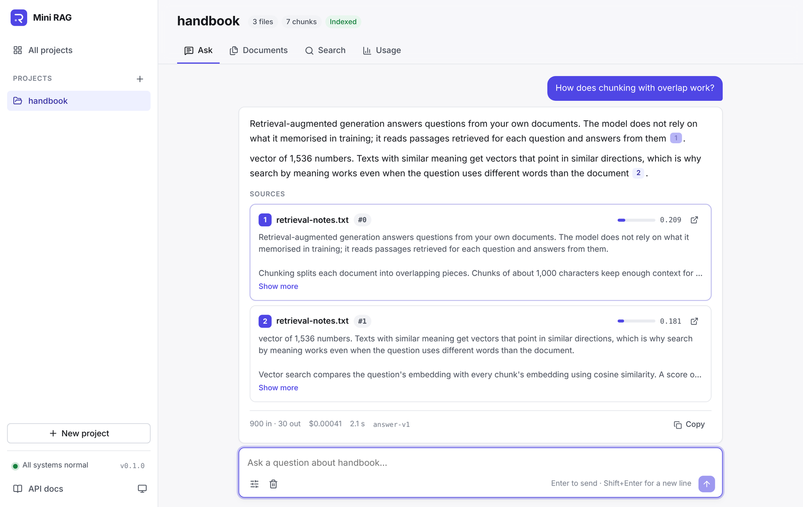
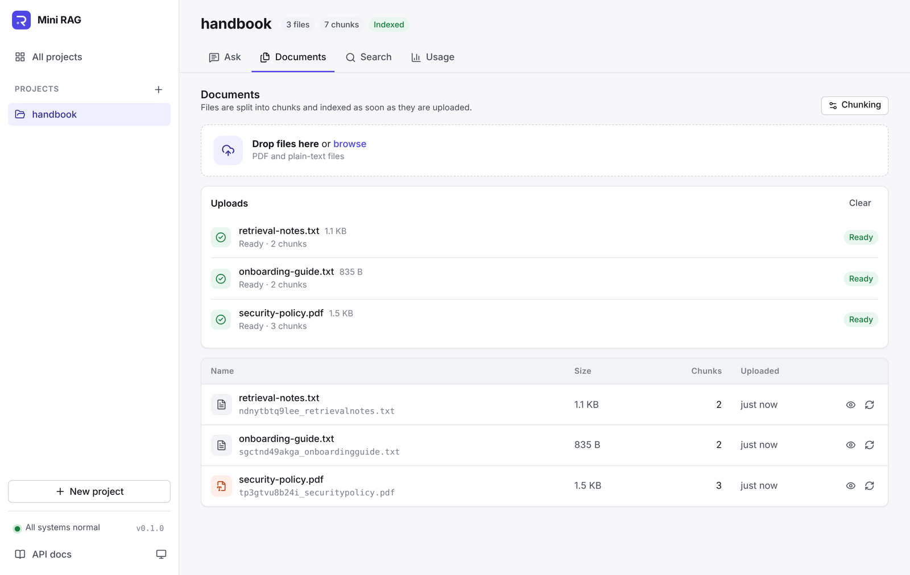
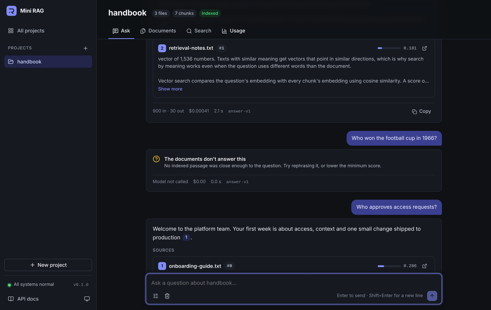

# Web app

The web app in `frontend/` is the interface for people: create projects, upload documents, ask questions and check usage, without writing a request by hand. It uses only the public API, so it shows what any other client can do.



## Pages

| Page | What it does |
|---|---|
| **Projects** | All projects with their file, chunk and index counts. A new project is kept in the browser until its first file is uploaded, because the API creates a project with its first upload. |
| **Ask** | Questions answered from the project's documents. Answers stream as they are written and can be stopped. Each `[n]` marker is a link to its source, and every source opens at its chunk in the document. A question the documents don't answer says so plainly. Each answer shows its tokens, cost, time and prompt version. The settings set the number of sources, the minimum score and streaming. |
| **Documents** | Drop PDF or text files: each one is uploaded with a progress bar, split into chunks and indexed, with its state shown at each step. Files list their size and chunk count; a file's chunks open in a side panel, and a file can be re-processed with other chunking options. |
| **Search** | Passages that match a query by meaning, best first, with their scores and the query's words highlighted. |
| **Usage** | Questions asked, how many were answered, tokens and cost for the project. |

When chunks are not indexed yet, for example because no embedding model was configured during the upload, a banner offers to index them. The sidebar shows whether the API and the database are reachable.

The questions and answers on the Ask page are kept in the browser tab (session storage) so they survive moving between pages; the server stores only their token usage and cost. Each question is answered on its own until conversations are added (see the [roadmap](roadmap.md)).



It follows the system's light or dark theme, or the one chosen in the sidebar, and works on phones.



## How it is built

| | |
|---|---|
| Framework | Vue 3 with `<script setup>` and TypeScript, Vue Router; no UI framework, the styles are design tokens in `src/styles.css` |
| Build | Vite; `vue-tsc` type-checks every build |
| API client | `src/api/client.ts`: typed calls for every endpoint; errors become an `ApiError` with the API's signal and a readable message. Uploads use `XMLHttpRequest` for progress, streamed answers read Server-Sent Events from a `fetch` response (`src/api/sse.ts`), since `EventSource` cannot send a `POST` |
| State | Small composables in `src/composables/`: the project list, the current project, the upload pipeline, the questions on the Ask page |
| Tests | Vitest: the event-stream reader, the API client, citation parsing, formatting and the answer component |
| Serving | nginx (unprivileged) serves the built files, sends every page path to `index.html`, caches hashed assets for a year, and forwards `/api`, `/docs` and `/openapi.json` to the API without buffering, so streamed answers arrive event by event |

Answer text is always rendered as text, never as HTML, so a document cannot inject markup into the page.

```
frontend/
├── src/
│   ├── api/            # Typed API client, Server-Sent Events reader, response types
│   ├── components/     # Sidebar, drop zone, source card, chunk panel, answer text, ...
│   ├── composables/    # Shared state and the upload pipeline
│   ├── lib/            # Formatting, citation parsing, error messages
│   ├── views/          # Projects, project pages (Ask, Documents, Search, Usage), not found
│   └── __tests__/      # Vitest unit tests
├── Dockerfile          # Node build, then nginx
└── nginx.conf.template # API address and DNS resolver come from the environment
```

## Running it

With Docker, `docker compose up --build` serves it on **http://localhost:3000**. For development, run the API (see the [README](../README.md#quick-start)), then:

```bash
cd frontend
npm install
npm run dev     # http://localhost:5173
```

The nginx image reads two settings: `API_UPSTREAM` (default `http://app:8000`), the API's address, and `NGINX_RESOLVER` (default `127.0.0.11`, Docker's DNS), which resolves that address on each request so a restarted API container is still found.
